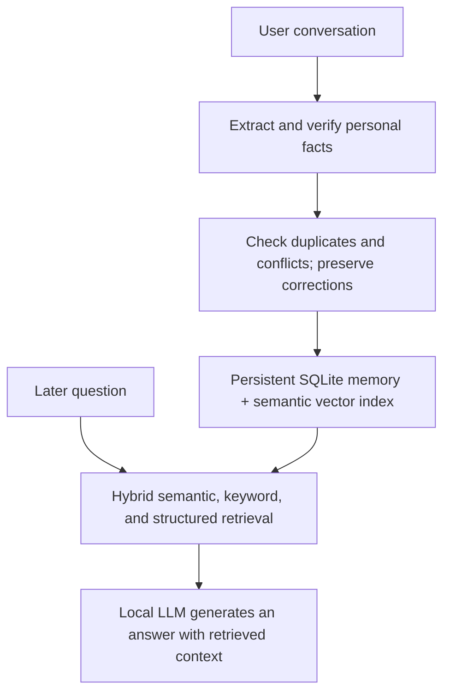

# Infonity

[](https://github.com/artur-gajewski/infonity/actions/workflows/tests.yml)

Infonity is a local personal assistant with persistent, evolving memory: a **memory-augmented LLM** that combines retrieval-augmented generation (RAG) with long-term memory management. It manages Documents, Todo, Reminders, Links, and personal facts through plain English.

React and FastAPI provide the interface and API. Native Ollama interprets requests and generates replies; SQLite stores knowledge independently of the model. FTS5, structured matching, and sqlite-vec support hybrid retrieval. Runtime inference uses local models.


## RAG with long-term memory

Traditional RAG retrieves information from a supplied knowledge base, often documents. Infonity also builds and maintains personal knowledge through conversations: it extracts facts, verifies them against the user's words, stores them, and preserves corrections over time.

| Capability | Traditional RAG alone | Infonity |
| --- | --- | --- |
| Retrieve relevant information | Yes | Yes |
| Vector embeddings and semantic search | Common | Yes, alongside keyword and structured search |
| Build knowledge from conversations | Requires additional memory management | Automatically extracts and verifies personal facts |
| Remember personal facts across sessions | Depends on supplied sources | Persistent SQLite memories |
| Handle conflicting facts and corrections | Requires additional memory management | Can supersede conflicting personal claims and preserve versions |
| Forget information | Usually by removing sources and indexes | Explicit deletion with confirmation in chat and the UI |
| Track memory history | Depends on the source system | Version history and provenance |
| Automatically save memories | Requires additional memory management | Supported facts are saved automatically; no suggestion approval step |

Memory formation and memory recall are separate processes:

- **Memory formation:** extract and validate facts, check source evidence, handle duplicates and conflicts, and persist supported memories. Corrections preserve history, explicit deletion removes linked versions, and manual consolidation merges exact duplicates.
- **Memory recall:** retrieve relevant memories through hybrid semantic, keyword, and structured search, then supply them to the local LLM as context for an answer. This is the RAG part of the system.

For example, “I prefer Clojure over Java” can become a verified personal memory. A later question about programming preferences can retrieve that fact:



### Does it learn?

At the application level, yes. Saying “Remember that my favorite language is Scala” can add a fact to SQLite and its retrieval index. That knowledge persists between sessions and can inform later answers. **The model's neural-network weights do not change:** this is persistent application memory, not model training.

A descriptive name is **Persistent Memory-Augmented Generation (MAG)**, though MAG is not a universally standardized category. The architecture can be expressed as:

**Personal AI = LLM + RAG + Memory Management**

The memory layer adds extraction, verification, consolidation, temporal validity, correction, and forgetting. Local model interpretation also drives validated collection actions. These mechanisms can make mistakes; source checks and version history help manage them, but do not guarantee correct extraction or conflict resolution. See [architecture](docs/architecture.md) and [memory lifecycle](docs/memory-lifecycle.md) for details.

## Start with Docker

On macOS, enable **Docker Desktop → Settings → Resources → Network → Enable host networking** and apply/restart. Start native Ollama with cloud features disabled:

```sh
./scripts/start-ollama.sh
```

In another terminal:

```sh
ollama pull qwen3:4b
ollama pull nomic-embed-text
docker compose up --build -d
```

Open **http://127.0.0.1:18473**. Docker serves both the UI and API; no host Python or Node installation is needed. Native Ollama retains Apple Silicon GPU acceleration. See [Docker setup and troubleshooting](docs/docker.md).

## Use plain English

The local LLM selects a structured action. The backend validates its fields and target, executes the corresponding application service, and reports the result. The model cannot call arbitrary endpoints or execute code.

| Request | Result |
| --- | --- |
| Add todo buy groceries | Save a Todo item |
| Save these notes in documents: Meeting moved to Tuesday | Open a prefilled document dialog; review and choose Create document |
| Keep https://example.com in my links | Save a link |
| Give that link the title Example | Change its title while preserving its URL |
| Remind me to call the dentist on Friday | Save a reminder note |
| Show links for my favorite foods | Filter saved links |
| Show links containing www | Filter link content |
| Show me links for programming | List links; conversational testing language is not a search filter |
| Change the milk task to buy oat milk | Edit task content |
| Mark groceries as in progress | Change task status, keeping its name |
| Set meeting as unsure | Save the custom status `unsure` |
| Update groceries as waiting for delivery | Save another custom status |
| Show todos with status blocked | Filter by status |
| Remove the dentist reminder | Ask for deletion confirmation |
| Erase all my todos | Ask to confirm the selected Todo items |

Todo and reminder statuses are free text, up to 100 characters. `mark`, `set`, and `update` support status requests. `done`, `complete`, `completed`, and `finished` also set the compatibility `completed` flag; other labels do not. Lists display statuses after the item, such as `karate [unsure]`. The initial `todo` status is omitted from the chat list. Use “Reopen the karate task” or set a different status to change it again.

Missing content or ambiguous targets prompt a clarification. Follow-up answers use the same conversation. Exact quoted deletion names take precedence over a longer entry that merely contains the name. Shared exact titles require clarification.

Deletion requests show the selected items before execution. **Confirm** deletes them; **Cancel** or **Escape** keeps them. Requests expire after ten minutes and reject changed items. A bulk confirmation captures a selection: items added afterward are not included.

Document creation from chat opens a dialog with separate Title and Body fields. Review the draft and choose **Create document** to save; Cancel or Escape discards the unsaved draft. The creation dialog requires both fields. Document titles in chat lists and the library open the full stored body; **Edit memory** opens the version-preserving editor. The API and editor also support a titled document with an empty body. Saved URLs are clickable in chat and the library.

Reminders are stored notes with their date/time text. **Scheduled notifications are not implemented.** Documents store text or references, not uploaded document files. The single-line message input remains visible while the conversation scrolls; multiline content can be edited in the library or supplied through the API/JSON import.

## Conversations and personal memory

### Push-to-talk

In **Settings → Voice commands**, click **Learn**, then press and release the key you want to use. The mapping is empty by default and saved in this browser. **Clear voice key** removes it; Escape cancels learning.

While a text input or textarea in Infonity has focus, hold the assigned key to record English speech, then release to transcribe into that field at the cursor (replacing selected text). This also works in create/edit dialogs, including document titles and bodies. The field regains focus with the cursor after the inserted text.

Disabled, read-only, password, and non-text fields are skipped. The key is reserved in eligible fields, so choose a key you do not use for typing.

Shift, Control, Option (Alt), and Command (Meta) can be learned as standalone keys, with separate left/right mappings. Starting a shortcut with another key cancels a modifier-key recording without submitting it. Fn is supported only when the browser delivers its key events; macOS may handle Fn/Globe itself. Browser/OS-reserved shortcuts may not reach the page.

The mapping does not record outside Infonity. In chat, it falls back to the message field when no text field is focused and no modal is open. Closing the destination field before transcription finishes discards its text. Escape cancels a recording.

By default, review the draft and press Send; existing draft text is preserved. Enable **Automatically send voice messages** beside the voice key in Settings to send the complete chat draft immediately after transcription. This checkbox defaults to off and is saved in this browser. Other text fields are filled without submitting their forms, and destructive commands still require confirmation. There is no microphone button in the composer and no spoken reply.

Voice input records audio using the browser microphone, including Safari's MP4 format, and sends it only to Infonity's local `/api/speech/transcribe` endpoint. A local faster-whisper `small.en` model transcribes it on CPU with a five-candidate beam search. This favors accuracy over latency; longer recordings take more time than with the previous tiny model.

Audio is processed in memory, not saved to the database or sent to a cloud service. Recordings stop after 60 seconds; uploads are limited to 8 MiB.

Allow microphone access and open Infonity on localhost/127.0.0.1 (or a secure origin). On first permission approval, release and hold again if recording has not started.

Docker installs the speech dependencies and downloads the model during the build, then runs transcription offline. No Safari speech pack is needed. Native installs additionally require:

```sh
.venv/bin/python -m pip install './backend[speech]'
.venv/bin/python -c "from faster_whisper.utils import download_model; download_model('small.en', output_dir='data/speech-model')"
```

The initial dependency/model download requires internet. Set `LOCAL_AI_SPEECH_MODEL` to an existing local model directory to override the default. Speech transcription is independent of Ollama.

- Ordinary questions use the model’s general knowledge, even without relevant saved memories.
- Calendar questions receive the current local clock and the next seven dates. `LOCAL_AI_TIMEZONE` defaults to `Europe/Helsinki`.
- Durable personal facts such as “I like pizza” are extracted, checked against the user’s source, and saved automatically in the background after a successful reply. Newly mentioned facts may take time to appear; pending extraction is cancelled at shutdown and is not replayed. There is no Suggestions section or approval step in the normal UI.
- To explicitly save a personal fact, say **“Remember that I like pizza.”** This uses the same extraction and verification process as automatically saved facts.
- To remove saved personal facts, name the topic: **“Forget that I like pizza”** or **“Forget my programming language preferences.”** **“Forget everything you know about me”** selects all personal facts in the General category. Review the selected records and choose **Confirm** to delete them; **Cancel** or Escape keeps them. Use `delete` or `remove` for Todo, Reminder, Link, and Document items.
- Unsupported, secret-like, or ambiguous extracted claims are skipped. Explicit save failures produce a warning; background extraction does not send a completion or failure event after the reply stream closes.
- Corrections and edits preserve previous records in history. The Memory library provides category, type, scope, and lifecycle-state filters, provenance, titles, task statuses, editing, and deletion.
- Memory details below a reply identify records supplied to the response path. They do not prove that the model causally used every record. Replies omit raw memory IDs.
- The sidebar lists the ten most recent discussions; older history remains stored. Settings → Recent conversations → **Delete recent conversations** asks for confirmation and deletes all discussions, including older ones, while keeping saved memories.
- **Stop** or Escape stops an active chat request. When idle, Escape clears the message draft. Open dialogs handle Escape through their own cancel/close behavior.
- Dark is the default theme. The header switch saves the selected theme in this browser. The UI shows a spinner while awaiting a reply and hides model thinking content.

Settings includes local model selection, extraction/retrieval controls, sensitive-context opt-in, active-memory JSON export/import, vector rebuilding, and topic/all-memory deletion. Disabling extraction does not disable explicit category actions.

### How saved memories become response context

For ordinary chat, Infonity combines three ways of finding saved memories:

- **Keyword search** uses SQLite FTS5 to match words in the question against stored memory text.
- **Structured matching** compares question words with memory fields such as subject, predicate, category, scope, and title. Preference-overview questions also select preference records.
- **Semantic search** uses local embeddings to find similar meanings, even when the question and memory use different words. Candidates must pass a similarity threshold.

Infonity merges these ranked results using reciprocal rank fusion: records found near the top of multiple lists receive more weight. Confidence and importance also affect the final order. Eligible records are then selected within the memory count and token budgets. If semantic search is unavailable, keyword and structured matching still work.

Semantic similarity can include loosely related records alongside direct matches. **“Memories provided as context”** shows the records sent to the model for that response; it does not claim that every listed record influenced the answer.

**Memory limit per response** caps how many relevant saved memories are included as context for one AI response. For example, a value of **8** lets Infonity search across eligible saved memories and include up to eight relevant results; it does not restrict the search to eight memories or limit how many you can store. The memory token budget can reduce how many results fit. Direct collection requests such as “Show todo” use separate listing limits.

## Run natively or develop

Format supported source and documentation files with `npm run format --prefix frontend`. Check formatting without changing files with `npm run format:check --prefix frontend`. Prettier does not format Python, shell scripts, or SQL.

Requires Python 3.12+, Node.js 22+, and native Ollama. Installation and model downloads require internet access.

```sh
./scripts/setup.sh
./scripts/start-ollama.sh
# In another terminal:
ollama pull qwen3:4b
ollama pull nomic-embed-text
./scripts/start.sh
```

The production startup script serves the built frontend and API at http://127.0.0.1:8000. If Ollama is already running, configure/restart that service rather than starting a second one. `PYTHON=python3.14 ./scripts/setup.sh` selects another interpreter. Python must support SQLite extension loading, and sqlite-vec must match the machine architecture.

For development, run `./scripts/dev.sh` and open http://127.0.0.1:5173. Vite proxies `/api` to the backend. Run one backend worker.

Copy/edit `.env.example` for native settings. Saved model/retrieval Settings take precedence over environment values for editable fields on subsequent starts. Docker forwards the variables listed in `compose.yaml`.

## Verification

GitHub Actions runs storage, backend, and frontend tests plus the production frontend build on every push and pull request. Actual-model Ollama tests remain opt-in and are skipped in CI. The badge above shows the latest test workflow result on `main`.

Latest frontend verification on **2026-10-30**: **66 tests across 7 files passed**, and the TypeScript/Vite production build passed after the component refactor. Earlier backend, storage, and selected real-Ollama results are recorded separately in [verification details](docs/verification.md); those checks were not rerun for the frontend refactor. No real-browser visual audit was run.

```sh
./scripts/test.sh
# Docker backend suite:
docker build --target backend-test -t infonity-backend-tests .
```

Actual-model tests are opt-in and use temporary databases:

```sh
cd backend
LOCAL_AI_INTEGRATION=1 ../.venv/bin/python -m pytest tests/test_ollama_integration.py -v
```

To diagnose memory latency with actual local models, run from the project root:

```sh
.venv/bin/python scripts/benchmark_memory.py --runs 3 --size 10
```

The benchmark uses synthetic content and a disposable database; it never opens the application database. JSON output contains timings and counts, without prompts, memory text, or model responses. It separates extraction, verification, embedding calls, SQLite connection/transaction work, and remaining application work for save, index, retrieval, and answer stages. SQLite time includes Python work performed inside connection contexts. Retrieval's remaining time includes structured matching and ranking; keyword and vector queries are included in SQLite time.

Run 1 includes initial indexing of the synthetic background records (`--size`); later runs generally index fewer records, so compare the `processed` counts. The first run may include model loading, but does not force a cold model or clear caches. `first_visible_chunk_ms` measures the provider's first emitted text, not Ollama's first generated token: the provider buffers output to filter thinking. The benchmark does not include HTTP, intent interpretation, background-worker contention, or browser latency. It uses environment/`.env` model settings, not settings saved in the running app. Match those settings before comparing. Failed/degraded stages set `ok=false` and make the command exit nonzero.

Export model environment variables explicitly when overriding defaults; changing into `backend/` changes where a working-directory `.env` is read. See [Docker test commands](docs/docker.md) if using containers.

## Backups and privacy

```sh
python3 scripts/backup.py backups/infonity-2026-10-28.sqlite3
```

The SQLite backup includes history, provenance, exclusions, and pending requests. Memory JSON export includes active records only. Stop the application before restoring a database; move its current database and `-wal`/`-shm` sidecars aside, restore the snapshot, and restart. An older snapshot can restore forgotten data.

Storage is plaintext local SQLite. Use OS disk encryption and account controls. The API assumes a trusted, single-user workstation and has no account authentication; keep its loopback binding. Deletion provides logical removal and exclusion from future model context, not guaranteed physical erasure from SSDs, WAL, snapshots, exports, or backups. See [memory lifecycle and privacy](docs/memory-lifecycle.md).

## Source map

- `backend/app/main.py` — REST/SSE orchestration, confirmation endpoint, local-origin checks, static serving.
- `backend/app/actions.py` — validated action execution, matching, listing, title/status handling.
- `backend/app/provider.py` — Ollama intent parsing, extraction, verification, embeddings, and response filtering.
- `backend/app/intent-v1.txt` — versioned action interpretation policy.
- `backend/app/models.py` — memory and action schemas.
- `backend/app/memory.py` — persistence, version history, automatic saving, deletion requests, consolidation.
- `backend/app/retrieval.py` — retrieval, outbox indexing, assistant policy, clock/calendar context.
- `backend/app/config.py`, `db.py`, `migrations/` — settings and transactional storage migrations.
- `frontend/src/App.tsx` — shared UI state, API orchestration, chat/voice lifecycle, library filters, and remaining dialogs/settings actions.
- `frontend/src/components/` — typed sidebar, header, chat panel, memory cards/editor, document viewer, model settings form, and deletion confirmation dialog.
- `frontend/src/ui.ts` — shared categories, Settings type, and document-title helper.
- `frontend/src/api.ts` — HTTP and SSE transport; `LinkifiedText.tsx` — safe clickable text links.
- `frontend/src/VoiceInput.tsx`, `VoiceKeySettings.tsx`, `voiceKeys.ts`, and `dictation.ts` — local push-to-talk, learned keys, and text-field insertion.
- `frontend/src/style.css`, `*.test.ts*`, and `frontend/public/favicon.svg` — shared themes/layout, regression tests, and I favicon.
- `backend/app/speech.py` — serialized local faster-whisper transcription.
- `scripts/` — setup, startup, checks, and backup.

[Architecture](docs/architecture.md) · [API](docs/api.md) · [Memory lifecycle](docs/memory-lifecycle.md) · [Verification and limits](docs/verification.md)
