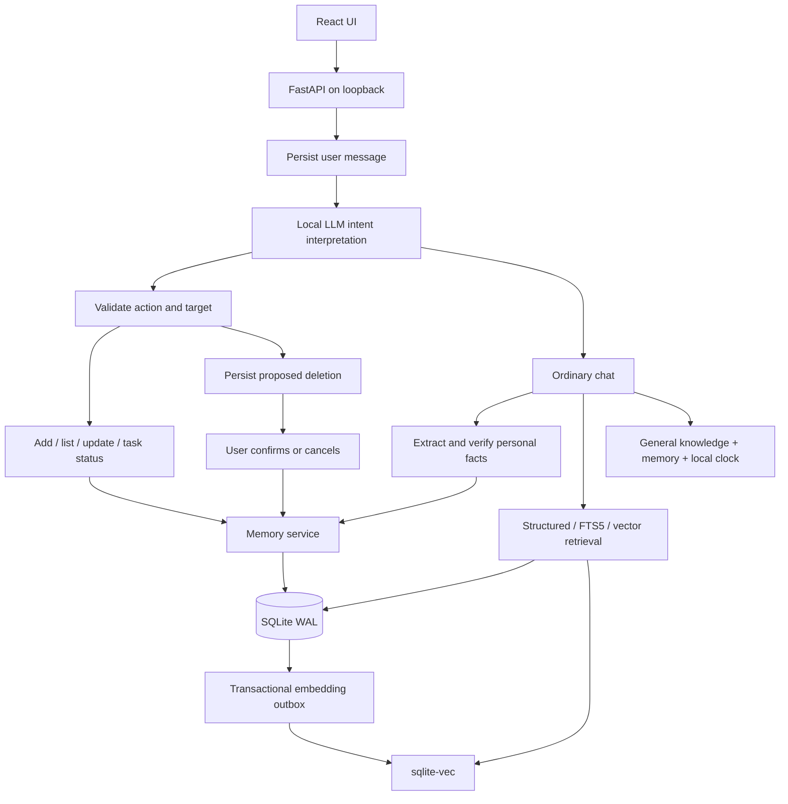

# Architecture

## Interpretation and execution

`Provider.interpret` sends the latest request, up to eight recent context messages, and bounded current-item previews to the local model. The model returns an `Intent` with an allowlisted action: `chat`, `add`, `list`, `update`, `delete`, or `clarify`. Pydantic validates the schema. Invalid output or unknown target handles gets one retry; persistent failure becomes a chat error.

The prompt uses labelled context rather than a JSON input object to reduce context echoing in JSON mode. Current items receive request-local handles such as `item_1`. The backend maps exact handles to database IDs and checks state/version before targeted mutations. It never approximates a mistyped UUID.

`actions.py` dispatches to the same memory service used by REST endpoints. Category actions return application-written results based on actual execution. The model chooses intent and arguments; it does not generate arbitrary HTTP calls or executable code. Exact legacy add/forget grammar remains a fallback when interpretation selects ordinary chat. Document-list actions additionally require an explicit collection-listing request in the latest message; misclassified content questions fall back to ordinary retrieval and answering, even after document edits.

A deletion action proposes a persisted selection. It does not execute removal. The confirmation endpoint validates the pending token, expiry, privacy epoch, and target versions under the application privacy lock and a SQLite write transaction. Cancellation consumes the request without deleting records. Confirmation operates on the captured IDs, not a newly expanded category query.

## Storage and history

SQLite is authoritative. Conversations persist independently of model state. Memory records carry category, title, value, structured identity, evidence, sensitivity, temporal bounds, lifecycle state, version, and origin. Todo/reminder `task_status` is a separate free-text field; `completed` is a compatibility flag derived from recognised finished labels.

Changing a title preserves content, including a link URL. Changing task status preserves content and title. Generic content edits preserve the task status. Edits create a new record, supersede the previous one, copy sources, and add an `edited_to` link. Corrections use `superseded_by`. `memory_sources` associates records with source messages; `message_memories` records which memories were supplied with a reply.

Numbered SQL migrations run transactionally at application construction and advance `PRAGMA user_version`. Current migrations add categories, pending deletion requests, titles, completion, and free-text task statuses after the initial/provenance schemas. Existing completed records migrate to `done`; other records start at `todo`.

WAL, foreign keys, busy timeout, and secure-delete are enabled. Versioned edits and confirmed deletion use write-lock checks. The application supports one local user and one server process.

## Retrieval and indexing

Memory triggers maintain FTS and the durable embedding outbox. Updates remove stale cached embeddings/vector entries. A five-second worker and bounded pre-chat batches process queued versions. Before writing vectors, the worker rechecks that each memory still exists at the queued version.

Embeddings record the configured model, installed-model digest, dimension, and record version. Model/dimension changes invalidate or rebuild the index. Failed jobs remain queued. Keyword and structured retrieval remain available when the embedding model is missing or inference fails.

Retrieval combines lexical, structured, and vector rankings with reciprocal rank fusion. Current retrieval excludes superseded, retracted, expired, future-dated, and disallowed sensitive records. Historical wording enables historical lexical/structured lookup. After retrieval and ranking, `memory_limit` (**Memory limit per response** in Settings) caps the selected context records; it does not restrict the search to that many records. A value of 8 includes up to eight relevant memories in one response. A character-based budget (`memory_tokens * 4`) can reduce that count further. The budget measures the compact JSON actually sent to the model, omitting storage timestamps, confidence scores and other bookkeeping; the UI and reply provenance retain the complete selected records. Neither setting limits memory storage.

Retrieval removes common question words and boosts informative matches in record content. Uploaded section filenames do not independently qualify every section as a lexical/structured match. A selected document section can bring one adjacent eligible section with the same filename, scope and lifecycle state, within both existing budgets, so instructions split across boundaries remain together. Once document bodies match, unrelated sections matching only through semantic similarity are not added as filler. Semantic retrieval still supports questions phrased differently from the source.

Explicit requests for a named person or team’s contact email/details use a conservative source-backed lookup instead of free-form model generation. An address must match the requested identity, be explicitly labelled with that identity, or be stored as that subject’s email. Mere proximity to a team name in a document does not establish ownership. Matching email sources are prioritized during retrieval, and missing direct evidence produces an uncertainty response.

Short follow-ups beginning with “how about”, “what about” or “and” include the previous user request in retrieval, retaining a named contact target when present. Current source context follows conversation history so earlier assistant mistakes do not take precedence. The response policy treats blank extracted PDF fields as missing evidence rather than exemptions or exclusive procedures. Previously imported PDF records can retain drawing-order errors until reimported or corrected through version-preserving edits. Layout-aware extraction repairs this ordering for new imports but cannot recover text absent from a PDF’s text layer.

Source guards also exclude legacy personal claims whose evidence is a question or does not express the preference claimed by their predicate. This filtering does not modify the saved record or its history.

Direct category listing uses stored records rather than free-form model recall. Lists show at most 50 items. Target interpretation uses at most 100 relevant/recent item candidates and bounded previews; long content is marked truncated. Exact names, duplicate-title clarification, grounded save content, version checks, and deletion guards supplement model interpretation.

## Ordinary answers and provider behavior

The ordinary `chat` path retrieves existing context and generates a reply before
queuing automatic extraction and verification. Background extraction is serialized;
supported unambiguous facts are saved with the usual source checks. An explicit
`remember` request still waits for extraction and verification before replying.
Ordinary chat no longer processes the embedding outbox before retrieval; the
five-second worker indexes saved records. General knowledge does not require a
matching memory. The system prompt supplies the local clock and next seven
calendar dates using `LOCAL_AI_TIMEZONE`.

Background extraction tasks are tracked in this process and cancelled at shutdown.
They are not a durable queue or replayed after restart. Failed, interrupted, or
cancelled replies do not queue extraction. A `memory` event with `pending=true`
announces background work; it does not confirm a save, and no later completion
event is sent on the closed reply stream. Newly extracted facts may not be
available to an immediately following request. Background inference can compete
with subsequent replies for Ollama resources. The source-exclusion checks still
prevent deletion during extraction from restoring a fact, and a changed privacy
epoch skips queued work before inference.

The response policy asks for complete actionable procedures, every relevant notification role, and distinct responsibilities, without inventing primary contacts or urgency. The response policy prioritises the latest message and treats retrieved records as optional context. Shared words alone do not establish relevance; memory subjects, predicates, and scopes must be preserved rather than turning attributes into preferences.

Memory JSON is user-role untrusted data, never system policy. It may inform answers but cannot grant actions. Source verification, prompt policies, and backend checks reduce model mistakes; they are not a formal guarantee of correct interpretation.

`Ollama` uses loopback HTTP with cloud-alias checks before personal content is sent. Intent parsing, extraction, and verification request structured output. A specific model-vocabulary/schema error falls back to JSON mode with local schema validation. Intent parsing retries invalid output once.

Generation requests thinking disabled and ignores Ollama's separate thinking field. Inline thinking blocks, including orphan closing tags, are stripped before responses are emitted. The provider buffers generation until completion so reasoning cannot flash before a closing tag arrives. Empty output produces an error.

## Browser

The browser uses same-origin fetch and SSE for POST chat. The UI shows a spinner while awaiting the final reply and displays errors in chat rather than an empty assistant placeholder. FastAPI serves production assets; Vite provides the development proxy.

Both themes use a neutral gray palette. Dark is default. Browser localStorage holds the theme (`still-theme`), learned voice key (`sheldon-voice-key`), and voice auto-send preference (`sheldon-voice-auto-send`). Personal records are fetched from the API rather than stored in localStorage/IndexedDB. Assistant replies use react-markdown with GitHub-style Markdown, with raw HTML skipped, remote images rendered as alt text, and external links restricted to HTTP(S). User messages and stored content remain escaped text. Document-list links retain application-controlled navigation. API responses use `Cache-Control: no-store`.

Each view has a single page title in the top bar. Navigation contains New conversation, Memory library, Settings, Upload file, and the ten most recent discussions. Category filtering is inside the library. The composer is a single-line input with Enter to send. A viewport-sized flex layout keeps it visible while only the conversation pane scrolls; library/settings views scroll within their own workspace. Visual-viewport resizing adjusts the app height when a mobile keyboard changes the available space. General UI text is `1.125rem`, with the restored larger Infonity wordmark and `1em` past-conversation links. The favicon uses the circular I mark.

## Frontend components and ownership

`App.tsx` owns shared application state, API mutations, streaming/abort control, voice routing, modal focus management, and refreshes. Presentational components receive typed props and callbacks; they do not issue API requests. This keeps version checks, deletion confirmation, and post-mutation refresh behavior coordinated in one place.

| Module                              | Responsibility                                                                          |
| ----------------------------------- | --------------------------------------------------------------------------------------- |
| `components/Sidebar.tsx`            | Navigation, recent conversations, and Ollama connection status                          |
| `components/AppHeader.tsx`          | Current page title, theme switch, and model name                                        |
| `components/ChatPanel.tsx`          | Empty-state examples, messages, document links, provenance, waiting state, and composer |
| `components/MemoryCard.tsx`         | Library item preview and inspect/edit/delete callbacks                                  |
| `components/MemoryEditor.tsx`       | Controlled memory fields, including document bodies and free-text task status           |
| `components/DocumentViewer.tsx`     | Full document body and edit/close controls                                              |
| `components/ModelSettingsForm.tsx`  | Controlled model and retrieval/extraction settings                                      |
| `components/ConfirmationDialog.tsx` | Confirmation text and confirm/cancel controls                                           |
| `ui.ts`                             | Shared category labels, Settings type, and document-title fallback                      |
| `api.ts`                            | JSON HTTP requests, import-field selection, and chat SSE transport                      |
| `LinkifiedText.tsx`                 | Safe link rendering without interpreting saved text as HTML                             |

Library filters, provenance details, the document creation dialog, and import/export/forget actions remain in `App.tsx`. Shared styling stays in `style.css`; extraction preserves existing CSS classes and DOM behavior.

Chat document-add actions emit a `document_draft` event instead of saving immediately. The latest message must explicitly request document creation; otherwise a model-proposed document addition falls back to ordinary chat and personal-memory extraction. The dialog receives the proposed title/body; submitting creates the record through `POST /api/memories`. Cancel or Escape discards the draft. Chat lists and library document titles open the stored document in `DocumentViewer`; edits use the same version-checked memory API as other records. The creation form requires a title and body, while the memory schema/editor allow a titled document with an empty body.

The composer supports Stop or Escape to abort an active request and Escape to clear an idle draft. Modal focus is trapped and restored centrally; dialog Escape behavior takes precedence over chat cancellation. Settings can delete all conversation history after confirmation, including discussions outside the recent-ten sidebar, without removing saved memories.

## Local voice input

`VoiceKeySettings.tsx` learns a browser-delivered key, including separate left/right modifiers. `VoiceInput.tsx` records while the key is held, selects a browser-supported audio format, stops at 60 seconds, and uploads to the local transcription endpoint. Escape cancels recording; another key cancels modifier recording when it starts a shortcut.

`dictation.ts` inserts recognized text at the selected text field's cursor, replacing its selection and restoring focus. `App.tsx` routes dictation to eligible text inputs and textareas, including modal fields, with a chat-composer fallback when no modal is open. Disabled, read-only, password, and non-text controls are excluded. Auto-send defaults to off; enabling it sends the full chat draft after transcription finishes, but never submits other forms.

The API serializes transcription and runs `SpeechService` in a thread pool. faster-whisper loads a local `small.en` model lazily on CPU with int8 computation, four threads, English decoding, five-candidate beam search, and voice-activity filtering. Audio is decoded in memory and is not saved. Docker downloads the model at build time and runs with offline model loading. Speech recognition is independent of Ollama.

## Uploaded document context

The raw-byte document upload endpoint extracts PDF text locally with pypdf in layout mode, reconstructing visual reading order so late-drawn hyperlink labels remain beside their instructions and contact names. Blank vertical padding is suppressed and rotated text is retained. It also
decodes UTF-8 TXT/Markdown. Bounded extraction produces sections of at most 1,600
characters so individual sections fit typical response memory budgets. Sections
are ordinary Documents memories with filename/part titles, saved in one transaction
through the memory service under the privacy lock after an epoch recheck. No new
database or schema is needed: existing FTS triggers, embedding outbox, sqlite-vec,
hybrid retrieval, versioning and deletion apply to every section. Original binary
files are not stored. Embedded instructions remain untrusted memory context.
